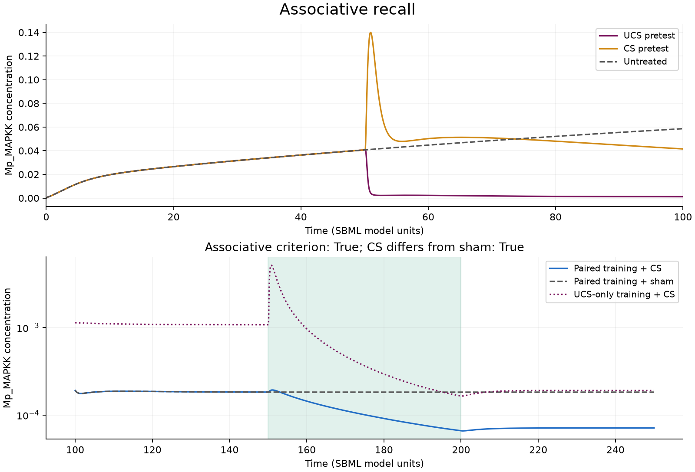

# GRN_ODE

This fork adds a runnable **Python/SBML replication of the intended memory
experiments**, using libRoadRunner and independently checking every selected
experiment with COPASI. The original MATLAB files and saved results remain here
as source material.

Start with the [Python guide and mathematics](python/README.md), the
[executed learning notebook](python/examples/memory_lab.ipynb), and the
[results and limits](python/RESULTS.md).

The [BioModels guide](python/models/README.md) explains the biology, reactions,
initial states, conserved quantities and role of the five demonstration models,
with links to the full 35-model catalog.

The examples cover retained responses, pairing, transfer, associative recall,
repeated stimulation, and a second intervention that reverses a response on
rechallenge. They use five original BioModels from the paper, not synthetic
substitutes. This is a replication of selected experiments and their operational
definitions; it is not a reproduction of the full 35-model survey.

The extension to all 35 models now includes independently compared
[baseline kinetics](python/CATALOG_VALIDATION.md) and a
[538-case single-input retention screen](python/CATALOG_MEMORY.md).
The [JAX catalog audit](python/CATALOG_JAX.md) independently validates 32 original
baselines and explicitly identifies three unsupported models.
The [repeated-stimulation screen](python/CATALOG_REPEATED.md) now also passes
all 538 cases across all 35, including matched isolated-pulse controls.
The [paired-learning screen](python/CATALOG_PAIRED.md) has evaluated all 4,208
cases: 4,166 pass and 42 remain failed or numerically unresolved. The original
results and complete coverage audit are published. The
[three-trial breaking screen](python/CATALOG_BREAKING.md) is
running after a successful 119-branch pilot; full-catalog breaking results remain pending. These catalog
protocols preserve native events, rule variables and delay history and separate
unresolved or physically invalid responses from interpretable effects.

## License

Original contributions in this fork are [MIT licensed](LICENSE), copyright 2026
Morgan Hough. The downloaded BioModels are covered by
[CC0](python/models/LICENSE). The inherited MATLAB scripts and saved data retain
their authors' rights; no upstream license file was supplied. See
[LICENSING.md](LICENSING.md) for the exact scope of each notice.

## Original repository description

a repository with code for the paper from Biswas, Clawson, and Levin 2022

This is the code used by Biswas in the 2022 paper on biological networks. All credit goes to her for the coding efforts. 
The code will be kept here temporarily as it is refactored. 

please contact:
wesley.clawson@tufts.edu 

with any questions
